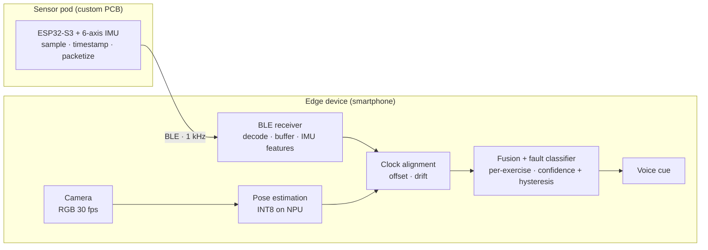

# CoachPocket

**A sensor-fused AI strength coach with real-time form correction.**

Final project for HUJI course 67546 (Engineering Project Workshop), Group 7.
Barak Kappah · Morel Avraham · Eitan Simckes

Project page: [Notion](https://app.notion.com/p/03f3bbd7caaa8320b7b60121d3fc1436)

---

## What it does

CoachPocket watches a barbell lift and tells you, by voice and within the same rep, when your technique breaks down.

It fuses two complementary channels on a single edge device:

- **Vision.** A smartphone on a tripod 2 to 3 m away runs on-device pose estimation (30 fps, INT8 on the NPU). Good for posture: lumbar rounding, knee valgus, elbow drift, bar path.
- **Inertial.** A custom wrist pod (ESP32-S3 + 6-axis IMU, our own PCB) streams 1 kHz motion data over BLE. Good for timing and dynamics: rep segmentation, tempo, eccentric duration, velocity transients, tremor.

The camera sees the body, the pod feels the movement. Fusion targets the faults where posture and timing interact, such as rounding that only shows up late in a fatiguing set.

**Latency budget:** fault onset to audible cue in under 300 ms.
**Privacy:** all processing is on-device. No cloud, no video upload.

## Architecture



The pod does no classification. It samples, timestamps locally and transmits. Everything else runs on the phone.

## Scope

| Tier | Exercises / goals |
|---|---|
| Core | Full pipeline (pod to voice cue), evaluated on 3 lifts |
| Target | Squat, deadlift, overhead press, bench press, barbell row, bicep curl, about 3 faults each |
| Stretch | Hexagon NPU deployment, adaptive training-plan module, broader subject testing, pod rev. B |

## Evaluation

- Per-fault precision, recall and F1 on a subject-independent split
- Three-way ablation: vision-only vs. inertial-only vs. fused
- False-cue rate, end-to-end latency, sync error, BLE packet loss, rep-count accuracy
- Dataset: about 900 labelled reps, balanced correct vs. deliberately faulted, defined with a certified trainer

## Team and ownership

| Member | Initial area |
|---|---|
| Barak Kappah (BK) | Embedded and hardware, PCB |
| Morel Avraham (MA) | Computer vision and on-device AI |
| Eitan Simckes (ES) | Fusion, data and application |

Each milestone has one accountable lead. Leads rotate so everyone gets hands-on time in every domain.

## Milestones

| ID | Weeks | Deliverable | Lead |
|---|---|---|---|
| M1 | 1 to 4 | Breadboard pod, BLE link, clock-sync protocol; pose pipeline live on device | BK (MA) |
| M2 | 5 to 9 | Synchronised capture and labelling tooling, first ~300 labelled reps; PCB rev. A | ES (BK) |
| M3 | 10 to 14 | Feature extraction, single-channel baselines, first fused classifier, INT8; mid-project demo | MA (ES) |
| M4 | 15 to 19 | Toward six exercises, cue management, app layer; pod rev. B | ES (BK) |
| M5 | 20 to 24 | Latency profiling and optimisation, false-cue tuning, full ablation | MA (ES) |
| M6 | 25 to 28 | Integration, unseen-subject trials, final demo, poster and report | BK (all) |

## Status

- [x] Project proposal submitted and approved
- [ ] Course Milestone 1: first report (due 17 Nov 2026)
- [ ] M1: breadboard pod and on-device pose pipeline
- [ ] MVP for demo day (end of Semester A)

## Repository layout

```
CoachPocket/
├── firmware/   # ESP32-S3 pod: IMU sampling, timestamping, BLE packetization
├── hardware/   # PCB schematics, layout, BOM, enclosure/strap
├── app/        # Edge-device app: camera, pose, BLE receiver, fusion, voice cues
├── ml/         # Data tooling, labelling, feature extraction, training, quantisation
├── docs/       # Reports, diagrams, measurement logs
└── README.md
```

`app/` is in:

- [app/README.md](app/README.md): build steps, modules, how detection works today, known limits
- [docs/pod-ble-protocol.md](docs/pod-ble-protocol.md): pod-to-phone packet format (draft, awaiting firmware review)
- [docs/data-collection.md](docs/data-collection.md): recording labelled sets and producing the precision/recall and ablation tables

The remaining folders are added as each component lands. Every component folder gets its own README with exact toolchain versions and build steps.

## Getting started

### Prerequisites

- Git and a GitHub account with access to this repo
- Per component (versions are pinned in each folder's README):
  - `firmware/`: ESP32-S3 toolchain and a USB cable to the dev board
  - `app/`: Android development environment and an Android phone with developer mode enabled
  - `ml/`: Python 3 with a virtual environment

### Clone

```bash
git clone https://github.com/MorelAvraham/CoachPocket.git
cd CoachPocket
```

Then follow the README inside the component you are working on.

## Contributing

- Each member commits their own work from their own GitHub account.
- Work on a branch per task (`feature/ble-link`, `fix/clock-drift`) and merge to `main` through a pull request.
- Commit messages describe the change, e.g. `firmware: add 1 kHz IMU sampling with local timestamps`.
- Tasks, schedule and requirements are tracked in [Notion](https://app.notion.com/p/03f3bbd7caaa8320b7b60121d3fc1436).

## Hardware

Android (or comparable) edge device plus a self-built ESP32-S3 + IMU pod from off-the-shelf parts. BOM is roughly $100.
